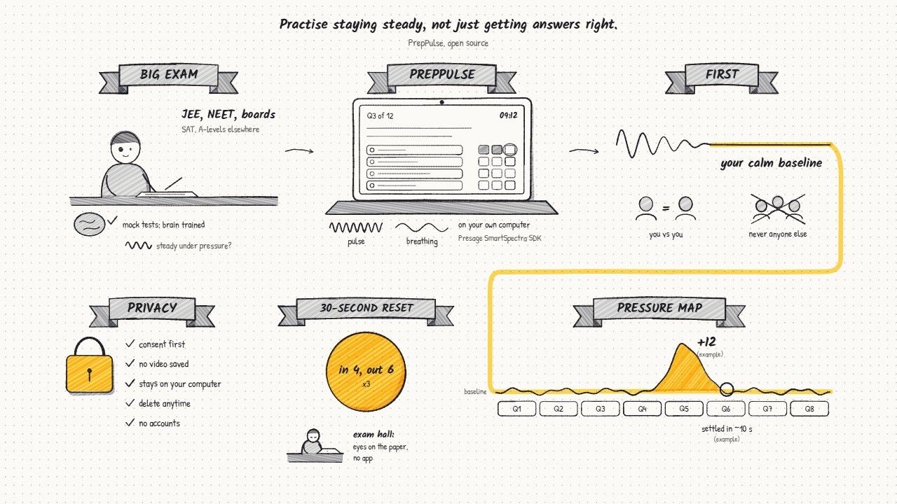
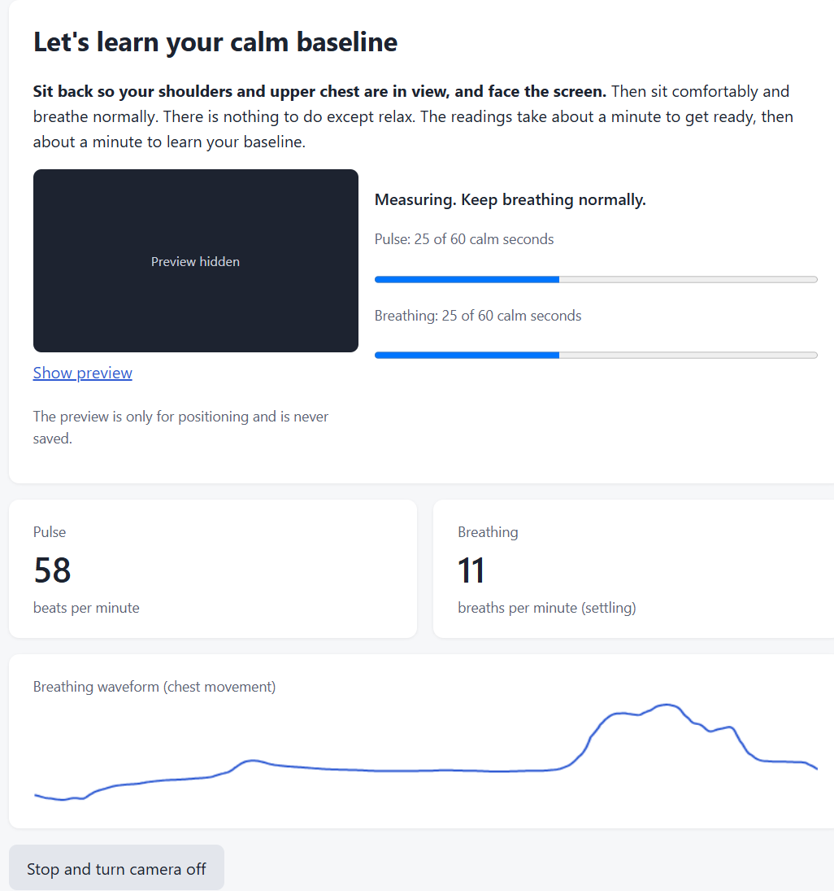
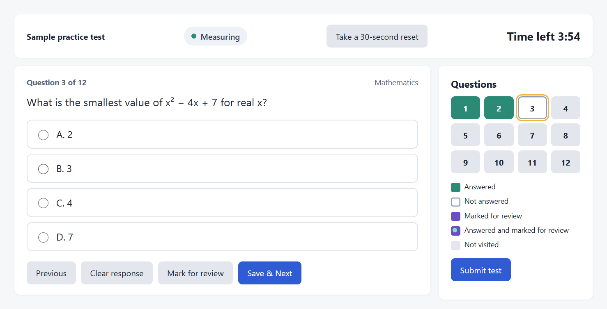
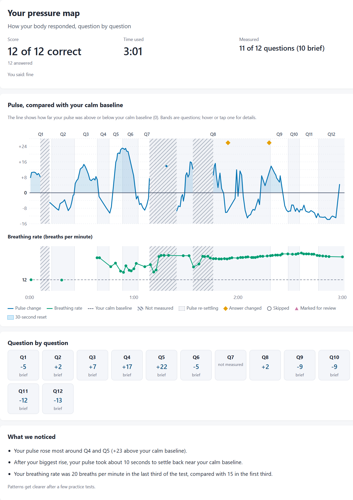
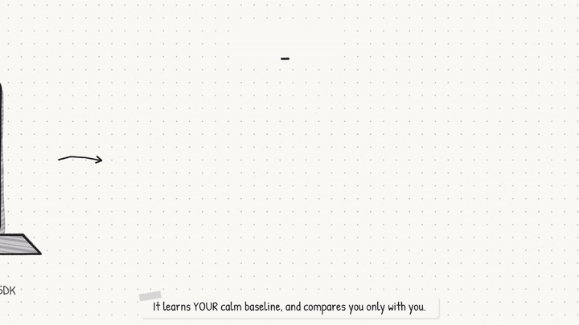
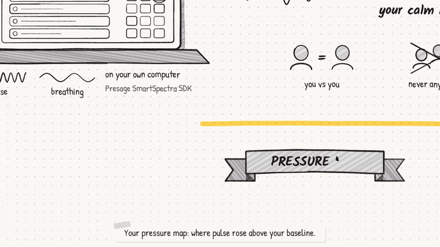
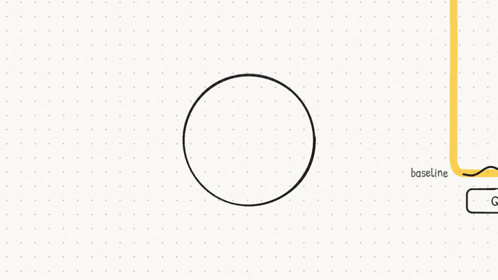

# PrepPulse

PrepPulse is a desktop app for students preparing for high-stakes exams (JEE/NEET, SAT, A-levels). You take a timed mock test while your webcam measures your pulse and breathing on your own computer, using the Presage SmartSpectra SDK. Afterwards "Your pressure map" shows how your body responded, question by question, compared only with your own calm baseline, plus a 30-second breathing reset you can practise.

PrepPulse is not a medical device. It does not diagnose anything and gives no medical advice.

Built for the Presage SmartSpectra SDK Challenge on DEV.

## Demo

[](https://drive.google.com/file/d/1HDlP3ThuLER15yxSrgaAixZgFv7g1ZJL/view)

**[Watch the demo video](https://drive.google.com/file/d/1HDlP3ThuLER15yxSrgaAixZgFv7g1ZJL/view)** (2:42, Google Drive). It opens with a 60-second hand-drawn explainer; its drawings and numbers are examples, not the app's screens. The calibration and mock-test footage is a real-time screen recording with the live webcam (camera preview hidden); the pressure map opens a saved live session from the app's past tests.

## Screenshots

From live webcam sessions measured with the SmartSpectra SDK, with the camera preview hidden. None of them use simulated data.

| Calibration | Mock test |
|---|---|
|  |  |

<details>
<summary>Your pressure map (a full report from a live 3-minute test)</summary>



</details>

### The idea in three sketches

From the explainer film. Simplified drawings, not the app's screens; the numbers are examples.

| A personal baseline | Your pressure map | The 30-second reset |
|---|---|---|
|  |  |  |

## Requirements

- Windows 10 or 11, x64. This is the only platform PrepPulse has been tested on. The SmartSpectra SDK also ships builds for macOS on Apple Silicon and Linux x64 (and Linux arm64, glibc 2.35 or newer), so the app may run there, but that is untested.
- Node.js 20 or newer (24 LTS recommended).
- A webcam.
- An internet connection: each camera session checks the API key with Presage and downloads the SDK's measurement models.
- A Presage API key for live measurement. Not needed to try the app with simulated data (see below).

## Setup

1. Get an API key from Presage at https://physiology.presagetech.com.
2. Copy `.env.example` to `.env` and put your key in it:

   ```
   SMARTSPECTRA_API_KEY=your-api-key-here
   ```

   `.env` is gitignored. The app reads the key only in the main process; it is never shown, logged or sent to the window.
3. Install:

   ```bash
   npm install
   ```

   This downloads the SDK's native runtimes for all four supported platforms (about 340 MB; only the one for your platform is loaded) and runs Electron's install step, which downloads the Electron binary (about 360 MB). Expect about 750 MB in `node_modules` in total.
4. Start:

   ```bash
   npm start
   ```

## Trying it without an API key

You can see the whole flow with a made-up recording: no camera, no SDK session, no network, no credits.

```bash
npm run simulate
```

This writes `data/recordings/simulated-test-session.json` (about 13 minutes of made-up readings, with warm-up, calm stretches, three pulse rises and two short measurement pauses). Then start the app in replay mode:

cmd:

```bat
set "PREPPULSE_REPLAY=data\recordings\simulated-test-session.json" && npm start
```

PowerShell:

```powershell
$env:PREPPULSE_REPLAY = "data\recordings\simulated-test-session.json"; npm start
```

(In PowerShell the variable stays set for that window; clear it with `Remove-Item Env:PREPPULSE_REPLAY`.)

Everything you see in replay mode is simulated data, not a measurement of anyone. Every screen shows a "SIMULATED DATA" banner, and sessions and baselines made this way are marked simulated and are never mixed with real ones.

## Troubleshooting

- **The app exits immediately with no window.** Your shell has `ELECTRON_RUN_AS_NODE` set (VS Code's terminal and some other Electron-based terminals do this). Clear it and start again: `set ELECTRON_RUN_AS_NODE=` in cmd, `Remove-Item Env:ELECTRON_RUN_AS_NODE` in PowerShell, or `unset ELECTRON_RUN_AS_NODE` in Git Bash.
- **The camera does not start.** Check Windows Settings > Privacy & security > Camera: "Camera access" and "Let desktop apps access your camera" must both be on. Close other apps that use the camera (video calls, the Camera app).
- **"Place more of the chest in view" or "sit back so your shoulders are in view".** The SDK only measures when it can see your face and upper chest. Sit further back, or tilt the screen down a little. Measurement will not start while this message shows.
- **It stays on "Getting ready" for a while.** Normal: the first steady pulse reading takes about a minute after the camera turns on. Use even light from the front and keep still.
- **Environment variables in cmd.** Quote the whole assignment, as in `set "PREPPULSE_REPLAY=data\recordings\simulated-test-session.json" && npm start`. Without the quotes, the space before `&&` becomes part of the value and the file is not found.
- **"No API key found".** `.env` is missing or still has the placeholder. See Setup.

## How PrepPulse uses SmartSpectra

PrepPulse uses `@smartspectra/node-sdk` 3.5.0 in Electron's main process, with the SDK's native camera capture (`useCamera`). The window never gets the API key and has no Node access.

PrepPulse uses pulse and breathing. It uses heart-rate variability only when the SDK provides it, which did not happen in our live tests. Signals used (requested metrics `[0, 2, 15, 16, 17]`):

- **Pulse rate** (`PULSE_RATE`): the main signal for the pressure map, as change from your calm baseline per question.
- **Breathing rate** (`BREATHING_RATE`): by third of the test.
- **Breathing trace** (`CHEST_BREATHING`, the chest waveform): drawn live during calibration and faintly behind the 30-second reset.
- **Heart-rate variability, only when the SDK provides it** (`HRV`, RMSSD): by half of the test, only when the SDK produced enough readings. It did not appear in our live tests (312 s of camera, metric 17 requested, no SDK errors, zero HRV readings), so expect the report to leave it out and the baseline to say it was not available. Nothing else in the app depends on it.
- `ARTERIAL_PRESSURE_TRACE` is requested only because the SDK delivers no pulse without it. Its values are not used or shown.

Facial expressions (`EXPRESSIONS`) and face landmarks (`FACE_LANDMARKS`) are deliberately never requested. Expression labels such as fear or anger are judgements about a person's state of mind, and PrepPulse only describes what the body did, never why or what it means. Landmarks are face geometry the app has no use for.

Where the SDK code lives:

- [`lib/vitals.js`](lib/vitals.js): the only module that talks to the SDK (`startSession`, `stopSession`, telemetry off, the requested metrics) and turns each metrics packet into plain numbers.
- [`main.js`](main.js): starts and stops the SDK session from IPC handlers, stamps every SDK event, and feeds calibration and the test session.
- [`lib/calibration.js`](lib/calibration.js), [`lib/session.js`](lib/session.js), [`lib/report.js`](lib/report.js): calibration, the test session and the report, all built from those numbers.
- [`scripts/probe.js`](scripts/probe.js): a developer probe that logs SDK timings from the camera.

## Consent and data handling

**Consent first.** The camera turns on only after you press "I agree, start camera" on the consent screen, in this run of the app. Consent is not remembered; it is asked again every time the app starts. There is no background or hidden monitoring: the camera is on only during calibration, a test, or a reset where you chose "Show my breathing", and it turns off afterwards.

**What is measured.** Pulse, breathing rate and the breathing waveform, read by the SDK from small colour changes in your skin and small movements of your chest in the camera image. Heart-rate variability is used only when the SDK provides it; it did not appear in our live tests.

**On your device.** Video is processed on your computer. PrepPulse never saves any video frame or image: not to disk, not in a recording, not in a log. No face images are kept. The small camera preview during calibration is kept in memory only, for display, and can be hidden.

**No location, no AI service.** PrepPulse does not access your location (the window is denied every permission request, including location). It does not use any AI service: no chatbot, no language model, no cloud analysis. The SDK has an optional feature that sends text to Presage for an AI-generated insight; PrepPulse never calls it. The observations in the report are fixed rules written in this repository (`lib/report.js`).

**Telemetry off.** The SDK's usage reporting is turned off (`enableTelemetry: false` in `lib/vitals.js`; the SDK's default is on). With it off, Presage's documentation says the SDK starts no telemetry session and transmits nothing for telemetry.

**The one online check, and credits.** When a camera session starts, the SDK contacts Presage's servers. Presage's documentation says a measurement authenticates against the SmartSpectra service and that there is no offline mode ([C++ headless mode](https://presagetech.com/docs/smartspectra-sdk/cpp/headless-mode); the Node.js docs do not say it separately), and that your plan has credits ([SmartSpectra SDK overview](https://presagetech.com/docs/smartspectra-sdk)), so each camera session may use credits. The SDK also fetches its measurement model files at start: the SDK's own log calls them encrypted, but we found no Presage documentation describing this. On what is sent, Presage's documentation says telemetry sends "no raw video or measured vitals values" ([Telemetry and Privacy](https://presagetech.com/docs/smartspectra-sdk)), and PrepPulse turns telemetry off. PrepPulse itself makes no network requests of any kind. Replay mode uses no network and no credits.

**Network connections observed.** Checked once, on 17 Nov 2026, during a live camera session: Windows 11 Pro (build 26300), PrepPulse with `@smartspectra/node-sdk` 3.5.0 in Electron 45.3.3, SDK telemetry off. The session ran consent, calibration (about 2 minutes), a 3-minute practice test, the check-in and the report, with the camera on for about 5 minutes. A script (`scripts/netwatch.ps1`) listed the TCP connections of the app's own processes once a second, from before the app opened until after it closed.

| Remote address | Port | Reverse DNS name | Seen (local time, IST) | Seen in |
|---|---|---|---|---|
| 76.223.65.59 | 443 | `a92d5d31dd2c27986.awsglobalaccelerator.com` | 21:02:40 to 21:07:36 | 77 one-second polls; states Established, SynSent and FinWait1, so it was opened more than once |
| 15.197.69.23 | 443 | `a92d5d31dd2c27986.awsglobalaccelerator.com` | 21:07:42 to 21:07:52 | 2 polls; Established |

What this shows, and what it doesn't:

- **Two remote addresses, both on port 443 (HTTPS), nothing else.** No connection was seen before the camera was turned on: the first appeared when the camera session started (21:02:40), the second during the last ten seconds before the camera turned off (the test ended at 21:07:42 and the camera stopped at 21:07:52). Nothing else connected between then and the app closing.
- **Who they belong to.** Both were made by the app's main process, which is where the SDK runs; PrepPulse's own code makes no network requests, so they come from the SDK. Their reverse DNS name is a generic Amazon Web Services Global Accelerator name (both addresses share one accelerator). It does not name Presage, so these connections cannot be identified as Presage's servers from the network data alone; that they are Presage's service is an inference from the SDK being the only code that connects.
- **Only metadata was observed.** The traffic is encrypted, and only connection metadata (address, port, state, timing) was recorded. What was sent inside these connections was not seen, so it is not claimed here beyond what Presage's documentation says.
- **Telemetry was off** (`enableTelemetry: false`) for this session.
- **Not checked:** UDP traffic, including DNS lookups (on Windows these go through the system's DNS service, not the app's processes, so they did not appear), connections that opened and closed within one second between polls, and other operating systems.

**What is stored, and where.** Only on your computer, in the app's data folder (on Windows `%APPDATA%\preppulse\preppulse-data\`; the exact path is shown in Settings):

- `baseline.json`: your latest calm baseline (pulse, breathing rate, HRV when available, and when it was measured).
- `sessions/<date and time>.json`: one file per practice test, with question timings, your answers and score, the measured numbers (pulse and breathing readings, and HRV readings when available, with timestamps), measurement pauses, and your optional check-in answer.

In replay mode, or with a developer test video, the baseline is kept in its own file (`baseline-simulated.json` or `baseline-dataset.json`), so it never replaces yours.

No video, images or face data are stored. Nothing is uploaded.

**Deleting.** Each past test on the home screen has a Delete button (with a confirmation). Settings has "Delete all my data", which removes the baseline and every session and clears the app's browser storage.

**PDF only when you ask.** "Save report as PDF" writes a file only to the place you pick in the save dialog.

**No accounts.** There is no sign-up, login or user account of any kind.

**Support is only triggered by you.** After a test, the optional check-in asks "How did that test feel?". Only the answer "Really overwhelming" brings up the support screen; you can also open it yourself from home or Settings ("Need to talk to someone?"). Your pulse, breathing, HRV or any other measured signal never trigger support content, a message or a suggestion. The phone numbers open your phone app only when you tap them; no website ever opens.

## Not a medical device

PrepPulse is a study-practice tool for general wellness and information. It is not a medical device, it is not cleared by any regulator, and it does not diagnose, treat or monitor any condition. Its readings are camera estimates, compared only with your own baseline.

## Support resources

If practice tests feel like a lot, it can help to talk to someone.

- **India:** Tele-MANAS, free, 24x7, in many Indian languages. Call **14416** or **1-800-891-4416**.
- **Outside India:** findahelpline.com lists free helplines by country.
- **If you feel unsafe right now, contact local emergency services.**

## Development

- Tests: `npm test` (Node's built-in test runner; synthetic inputs and the simulated recording on a virtual clock).
- Developer switches are documented in [`CLAUDE.md`](CLAUDE.md) (`PREPPULSE_REPLAY`, `PREPPULSE_VIDEO`, `PREPPULSE_VIDEO_LOOP`, `PREPPULSE_RECORD`, `PREPPULSE_DIAGNOSTICS`).
- Live session checklist: [`docs/live-session.md`](docs/live-session.md).

## Credits

- Vital signs: [Presage SmartSpectra SDK](https://physiology.presagetech.com) (`@smartspectra/node-sdk`).
- The question bank (`questions/sample-test.json`) is original, written for PrepPulse, and not taken from any real exam paper.
- Charts use the Okabe-Ito colour palette, chosen to be readable with colour-vision differences.
- Built with [Electron](https://www.electronjs.org).
- The explainer film and its sketches were made for PrepPulse. Hand-lettering: Patrick Hand and Kalam (SIL Open Font License). Voice-over: the [Kokoro](https://huggingface.co/hexgrad/Kokoro-82M) text-to-speech model (Apache 2.0).
