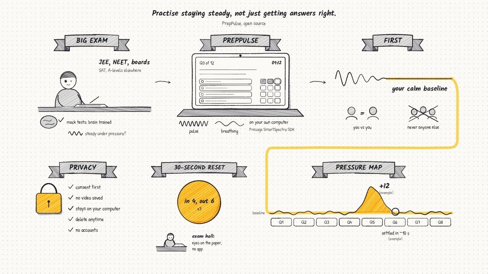
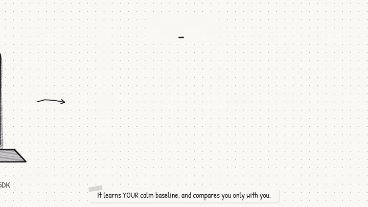
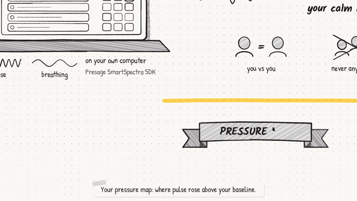
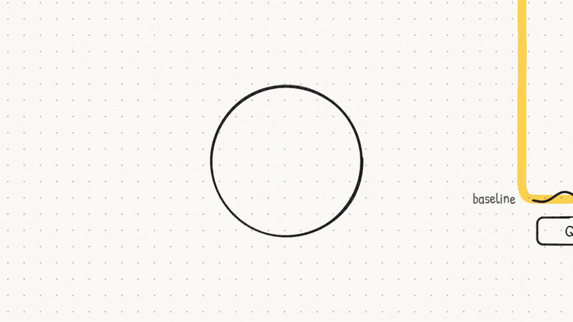

*This is a submission for the [Presage SmartSpectra SDK Challenge](https://dev.to/challenges/presage-2026-11-04)*

## What I Built

In India, a few exams decide a lot. JEE for engineering, NEET for medicine, and the Class 10 and 12 board exams shape which college, which city and which career a student gets a shot at. Lakhs (hundreds of thousands) of students sit them every year, many after two or more years of coaching, mock tests and ranked results. The same pressure exists everywhere under other names: the SAT, A-levels, the gaokao.

The numbers around student wellbeing in India are hard to read. NCRB data shows student suicides rising from 8,068 in 2014 to 14,488 in 2024 ([The Wire](https://thewire.in/education/over-1-23-lakh-students-died-by-suicide-from-2014-2024-exam-failure-family-problems-top-causes-ncrb)). In Tamil Nadu alone, calls to Tele-MANAS, the government's mental health helpline, more than doubled, from 37,258 in 2023 to 80,999 in 2024 ([Lokmat Times](https://www.lokmattimes.com/national/tn-govts-mental-health-helpline-a-lifeline-for-students-facing-exam-stress/amp)).

> If you or someone you know is struggling, Tele-MANAS is free, 24x7 and available in many Indian languages: call **14416** or **1-800-891-4416**. Outside India, [findahelpline.com](https://findahelpline.com) lists free helplines by country.

PrepPulse does not try to solve any of that, and it does not detect anything about anyone. It works on something smaller. School counsellors already teach students breathing techniques for exam days, but a technique learned in a calm room is hard to use in the exam hall. PrepPulse is a place to practise it under realistic conditions: you take a timed mock test, the webcam measures your pulse and breathing on your own computer with the SmartSpectra SDK, and afterwards you see how your body responded, question by question, compared only with your own calm baseline. Mid-test, you can take a 30-second breathing reset and later see what your pulse did around it.

It is a desktop app (Electron and Node), it runs entirely on your machine, and it has no accounts.

## Demo

🎬 **[Watch the demo video](PASTE_VIDEO_LINK_HERE)**

**The idea in 60 seconds.** Before the real app, a short hand-drawn explainer with a voice-over. It is a sketch of the idea, not the app's screens, and the numbers on its pressure map are examples.

**[EXPLAINER FILM: YouTube link]**



Every screenshot below is from a live webcam session, measured with the SmartSpectra SDK. None of them use simulated data.

**[SCREENSHOT: calibration, learning your calm baseline, with the live pulse and breathing trace]**

**[SCREENSHOT: the mock test screen, with the reset button in the header]**

**[SCREENSHOT: your pressure map, with the pulse timeline, question strip and observations]**

**[SCREENSHOT: the 30-second reset, with the live breathing trace behind the circle]**

## Code



Setup, in short: Windows 10 or 11, Node.js 20 or newer and a webcam. Put your Presage API key in `.env` (copied from `.env.example`; it is gitignored), then `npm install` and `npm start`. The README covers troubleshooting, including the one that bit me most: an `ELECTRON_RUN_AS_NODE` variable inherited from VS Code's terminal makes the app exit silently.

**For judges without a key:** `npm run simulate` writes a made-up recording, and starting the app with `PREPPULSE_REPLAY` pointed at it plays the whole flow (calibration, test, reset, check-in, pressure map) with no camera, no SDK session, no network and no credits. Every screen then shows a "SIMULATED DATA" banner, and simulated sessions and baselines are kept apart from real ones.

```powershell
npm run simulate
$env:PREPPULSE_REPLAY = "data\recordings\simulated-test-session.json"; npm start
```

## How It Responds to Human Signals

**The signals.** PrepPulse uses pulse and breathing. It uses heart-rate variability only when the SDK provides it, and it did not appear in my live tests. It requests five metrics from `@smartspectra/node-sdk` 3.5.0:

- **Pulse rate**, the main signal for the pressure map.
- **Breathing rate**, compared by third of the test.
- **The breathing trace** (the chest waveform), drawn live during calibration and faintly behind the reset circle.
- **Heart-rate variability, only when the SDK provides it.** If there are enough readings, the report adds it by half of the test. In my live webcam tests the SDK produced no HRV readings at all (metric requested, no errors), so the report left it out and the baseline said it was not available. Nothing else depends on it.

The arterial pressure trace is requested only because the SDK delivers no pulse without it; its values are never used or shown. All SDK calls live in [`lib/vitals.js`](https://github.com/tusharshah21/preppulse/blob/main/lib/vitals.js); [`main.js`](https://github.com/tusharshah21/preppulse/blob/main/main.js) starts and stops sessions and stamps every event; [`lib/calibration.js`](https://github.com/tusharshah21/preppulse/blob/main/lib/calibration.js), [`lib/session.js`](https://github.com/tusharshah21/preppulse/blob/main/lib/session.js) and [`lib/report.js`](https://github.com/tusharshah21/preppulse/blob/main/lib/report.js) turn the numbers into a baseline, a test session and a report.

**A personal baseline.** Before the first test of the day, PrepPulse learns your calm baseline. It waits until pulse and breathing have each given a stable reading once, then needs 60 calm seconds of each and at least 10 stable breathing readings. If breathing stays sparse, it stops at 180 seconds and says how many readings it got. Everything in the report is a change from this baseline. There are no population norms anywhere, and nothing is called high, low, good or bad.


*From the explainer: a sketch of the idea, not the app's screen.*

**Lining up questions with the body.** A pulse value summarises roughly the previous 12 seconds, so a question's own response shows up a few seconds after it appears. Each question's window is shifted 6 seconds later before its readings are taken. A question needs at least 6 seconds on screen and 4 seconds of steady pulse to get a value at all; values from short visits are labelled "brief" so you read them loosely.

**Honest gaps.** When the SDK says the position is not OK (face not found, chest not in view, too dark, too much motion) or no stable pulse arrives, that stretch is recorded as a gap with its reason and drawn as a gap. Nothing is interpolated. A question with too little data says "not measured" instead of guessing.

**Rises on the timeline.** A rise is the pulse staying at least 8 beats per minute above your baseline for at least 6 seconds. The report names the questions on screen during it and times how long the pulse took to come back within 4 beats of baseline.


*From the explainer: a simplified sketch, not the real report. "+12" and "~10 s" are examples, not measurements.*

**Observations from fixed rules.** Up to three sentences, written by rules in `lib/report.js`, only when there is enough data. From my live session: "Your pulse rose most around Q4 and Q5 (+23 above your calm baseline)." and "After your biggest rise, your pulse took about 10 seconds to settle back near your calm baseline." They describe what the body did, never why.

**The reset drill.** "Take a 30-second reset" is in the test header. A circle guides three slow breaths (4 seconds in, 6 out) while the live breathing trace runs faintly behind it, so you can see your chest follow the circle. The test timer keeps running, as it would in the exam hall, and the screen says so. The reset is drawn as a band on the pulse timeline, and the report compares the minute before with the minute after when there is enough data.


*From the explainer: the same three breaths work in the exam hall, with no app.*

**Why no facial expressions.** The SDK can return expression labels and face landmarks. PrepPulse never requests either. An expression label such as fear or anger is a judgement about someone's state of mind, made from their face, and that is exactly what this app should not do. It reports what the body measurably did and leaves the meaning to the student.

**Three things I learned:**

1. **The chest has to be in view.** I first sat close to the laptop like everyone does, and the SDK kept saying "Place more of the chest in view". Breathing comes from chest movement, so you need to sit back far enough for your shoulders and upper chest to be visible. The app now turns that status into "sit back so your shoulders are in view" and waits for a steady pulse before a test starts, so the first question is not lost to the camera warming up.
2. **A live camera is slower than a file.** During development (not in the demo), feeding a public research video through the SDK gave a first stable pulse after about 13 seconds; my live webcam took about 19, and breathing about 49 against 34, because the camera tunes itself first. (On Windows the SDK's file input couldn't open the video, so I fed frames through ffmpeg into its custom-input mode.) The report thresholds were retuned from the live numbers, not the file ones; the calibration thresholds were kept, apart from asking for more breathing readings.
3. **Why "brief" readings exist.** In my live test I spent 7 to 15 seconds on most questions, while a pulse value covers about 12. My first thresholds (15 seconds on screen) hid almost every question. Lowering them alone would have shown shaky numbers as if they were solid, so short visits get a value and a "brief" label instead.

## Prize Categories

**Best Thoughtful Real-World Use.** PrepPulse is for students preparing for high-stakes exams such as JEE, NEET and the Class 10 and 12 boards, and their equivalents elsewhere. The need it meets is practice: a calming technique only helps on exam day if you have used it under exam-like conditions, so PrepPulse builds that into the mock-test routine students already have.

It is built to be easy to pick up. There is no account; you need a webcam and a free-trial Presage API key. The test uses the familiar computer-based test layout (a question palette, mark for review, a countdown), with large question and answer text. When the camera could not measure, the report shows an honest gap instead of a guess. And replay mode lets anyone, judges included, try the full flow without a key.

It keeps everything on the student's own computer, compares them only with themselves, and is careful about what it does not claim: no diagnosis, no detection, no judgement.

## Consent and Data Handling

- **Consent before the camera.** The camera turns on only after you press "I agree, start camera" on a consent screen that says what is measured and how. Consent is asked again every time the app starts. The camera is on only during calibration, a test, or a reset where you chose to see your breathing, and turns off afterwards. There is no background monitoring.
- **On your device.** Video is processed on your computer. No video frame or image is ever saved, not to disk, not in a recording, not in a log. The small calibration preview stays in memory for display only and can be hidden.
- **No location.** The app window is denied every permission request, including location.
- **Telemetry off.** The SDK's usage reporting is switched off (`enableTelemetry: false`; the SDK's default is on).
- **The one online check, and credits.** When a camera session starts, the SDK contacts Presage. Presage's documentation says a measurement authenticates against the SmartSpectra service and that there is no offline mode ([C++ headless mode](https://presagetech.com/docs/smartspectra-sdk/cpp/headless-mode); the Node.js docs don't say it separately), and that you can check your plan and credits ([SmartSpectra SDK overview](https://presagetech.com/docs/smartspectra-sdk)), so each camera session may use credits. The SDK also fetches its measurement model files at start; I saw this in the SDK's own log, which calls them encrypted, but couldn't find it described in Presage's documentation. On what is sent: Presage says telemetry sends "no raw video or measured vitals values" ([Telemetry and Privacy](https://presagetech.com/docs/smartspectra-sdk)), and PrepPulse turns telemetry off. PrepPulse's own code makes no network requests, and replay mode uses no network and no credits.
- **What the network showed.** During one live session I logged the TCP connections of the app's own processes every second. There were two remote addresses, both on port 443, both from the main process where the SDK runs, both an AWS Global Accelerator name. The first appeared when the camera started, the second in the last ten seconds before it stopped, and nothing else connected. Only connection metadata was recorded, so what was inside those connections is not claimed beyond Presage's documentation. The full table and its limits are in the README.
- **Stored locally, and only locally.** Your calm baseline and one file per practice test (question timings, answers, score, the measured numbers with timestamps, measurement pauses and your optional check-in answer) live in the app's data folder, on Windows `%APPDATA%\preppulse\preppulse-data\`. Settings shows the exact path. Nothing is uploaded.
- **Delete one session or everything.** Each past test has a Delete button. Settings has "Delete all my data", which removes the baseline, every session and the app's browser storage.
- **PDF only when you ask.** "Save report as PDF" writes a file only where you choose in the save dialog.
- **No accounts.** No sign-up, no login.
- **No AI service.** No chatbot, no language model, no cloud analysis. The SDK's optional AI insight feature is never called. Every observation comes from fixed rules in the repository.
- **Support is triggered only by you.** After a test, an optional check-in asks "How did that test feel?". Only the answer "Really overwhelming" brings up the support screen with Tele-MANAS and findahelpline.com, and you can open it yourself from home or Settings. Your pulse, breathing or any other measured signal never triggers support content.
- **Not a medical device.** PrepPulse is a study-practice tool for general wellness. It does not diagnose, treat or monitor any condition. Its readings are camera estimates, compared only with your own baseline.

## Agent Session

I built PrepPulse with Claude Code. A curated agent session showing how it came together, including the live-run analysis and retuning, will be embedded here.

**[AGENT SESSION EMBED: replace this line with the agent_session tag once the session is saved]**

---

Thanks for reading. If you are preparing for an exam right now: one mock test is just one mock test, and a few slow breaths are always allowed. PrepPulse is open source under the MIT licence.
